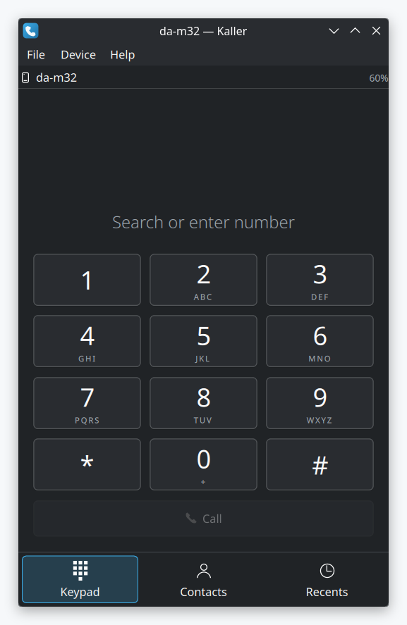
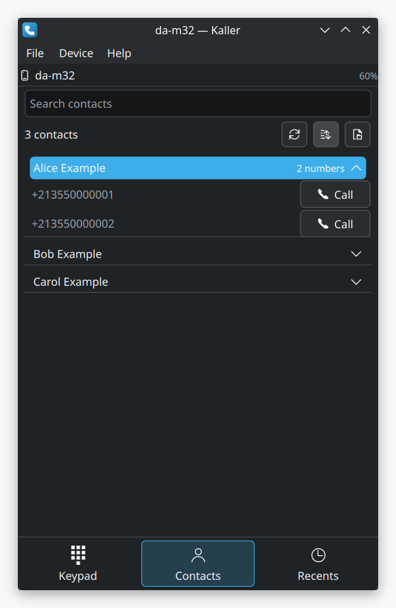
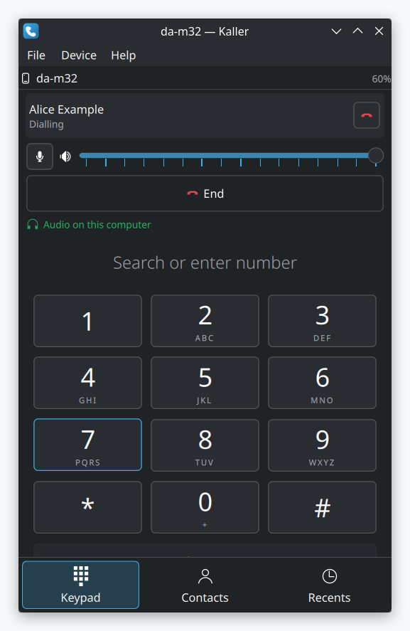

<p align="center">
  
</p>

<h1 align="center">Kaller</h1>

<p align="center">
  <strong>📞 your phone is ringing in the other room. answer it from your desk</strong>.
</p>

<p align="center">
  Make and receive phone calls on your KDE desktop, through a phone paired over Bluetooth.
  <br>The calling part of Windows Phone Link, for Linux. No account, no cloud.
</p>

<p align="center">
  <a href="https://github.com/AminBlg/kaller/actions/workflows/build.yml"></a>
  <a href="https://github.com/AminBlg/kaller/releases/latest"></a>
  <a href="LICENSE"></a>
</p>

<p align="center">
<picture>
  <source media="(prefers-color-scheme: dark)" srcset="docs/screenshots/keypad-dark.png">
  
</picture>
<picture>
  <source media="(prefers-color-scheme: dark)" srcset="docs/screenshots/contacts-dark.png">
  
</picture>
<picture>
  <source media="(prefers-color-scheme: dark)" srcset="docs/screenshots/in-call-dark.png">
  
</picture>
</p>

Kaller is a dialler for KDE Plasma. It sends commands to your phone over the Bluetooth hands-free profile (HFP). The call audio comes through this computer. The call itself stays on the phone and the mobile network. Kaller has no account, no cloud service and no telemetry.

Kaller was called Foner in version 0.1.0. It was tested with one Android phone and one iPhone, on Arch Linux with Plasma. No other desktop is tested yet.

## Requirements

- PipeWire 1.4 or newer, with its telephony module.
- BlueZ.
- A phone that is paired and connected over HFP.

If one of these is missing, Kaller starts and reports that no phone is connected.

## Install

Download the install script, read it, then run it as a normal user. The script installs the dependencies, builds Kaller, runs the tests, and installs to `/usr/local`. It asks for sudo only for the package install and the final copy.

```sh
curl -fsSLO https://raw.githubusercontent.com/AminBlg/kaller/main/scripts/install.sh
less install.sh
sh install.sh
```

To install into `~/.local` instead, set `KALLER_PREFIX`:

```sh
KALLER_PREFIX=~/.local sh install.sh
```

The script knows the package names for Arch, Debian, Ubuntu, Fedora, openSUSE and their derivatives. On another distribution, it stops and prints the dependency list. Install those dependencies yourself, then run the script again with `KALLER_SKIP_PACKAGES=1`.

| Distribution | Status |
|---|---|
| Arch Linux, CachyOS, EndeavourOS, Manjaro | Works |
| Fedora 42 and newer | Works |
| Ubuntu and Kubuntu 25.10 and newer | Works |
| Debian 13 | Works |
| openSUSE Tumbleweed, Leap 16.0 | Works |
| Ubuntu and Kubuntu 25.04 | Builds, but PipeWire 1.2 has no telephony module, so no calls |
| KDE neon | Builds, but PipeWire from the Ubuntu 24.04 base has no telephony module, so no calls |
| Ubuntu 24.04, Debian 12, RHEL 9, openSUSE Leap 15.6 | No KDE Frameworks 6, so no build |

Only Arch Linux with Plasma ran against a real phone. The other rows come from the package versions that each distribution ships.

## Build from source

Kaller needs Qt 6.5 and KDE Frameworks 6.8. `scripts/install.sh` lists the package names for each distribution. Install them, then run:

```sh
cmake -S . -B build -DCMAKE_BUILD_TYPE=Release
cmake --build build -j
ctest --test-dir build --output-on-failure
sudo cmake --install build
```

## Usage

Run `kaller`, then connect your phone. When the phone connects, Kaller reads the phonebook and the call history.

To try the contact list with no phone, open `docs/demo-contacts.vcf` with File > Import vCard. It holds invented contacts.

## Features

- Dial, answer and end calls. Answer from a desktop notification.
- Hold one call and answer another. Swap between two calls, or join them.
- Mute the microphone, set the speaker level, and send keypad tones.
- Pull the call audio onto this computer.
- Read the contacts and the call history from the phone, and keep them on disk.
- Search contacts by name, by number, or by keypad letters: `254` finds "Ali".
- Import and export vCard files.
- Close the window, and Kaller keeps running in the system tray.
- Open `tel:` links from other applications.

Two calls at once, service codes and vCard export are built, but nobody tested them against a phone yet. [docs/STATUS.md](docs/STATUS.md) lists what works and the known limits.

## Why Kaller

KDE Connect tells you that the phone is ringing. Kaller answers it. You dial and talk from the desktop, and the call audio comes through this computer. Windows has this in Phone Link. Kaller brings it to Plasma.

[HandsFree for Linux](https://github.com/PavelTarlev1/handsfree-linux) does a similar job with its own hands-free stack. Its README asks you to keep WirePlumber from claiming the hands-free role. Kaller uses the telephony module that ships with PipeWire 1.4, so it works with the audio stack that you already run.

## FAQ

Does KDE Connect do this? KDE Connect lists notifications, SMS, a shared clipboard and remote control in its README. That list has no call dialing, and the wiki was not checked. Kaller covers the calls.

Which phones work? Kaller was tested with one Android phone and one iPhone. Any phone that pairs over the Bluetooth hands-free profile can connect in theory, but only those two ran.

Do I need a phone to try it? You can start Kaller without one and import `docs/demo-contacts.vcf` to try the contact search. Calls need a paired phone.

Does it work outside Plasma? Kaller is built with Qt and KDE Frameworks. Other desktops were not tested.

Does Kaller send my contacts anywhere? Kaller has no account and no cloud service. It keeps the phonebook and the call history on your disk.

## Roadmap

- Keyboard-only operation. The keypad keys cannot be reached with Tab yet.
- Test more phones and more desktops.
- Package Kaller for more distributions.

[docs/STATUS.md](docs/STATUS.md) has the details.

## If you installed Foner 0.1.0

Kaller moves your settings and contacts over on its first start. The old program stays on your disk until you remove it.

If you installed Foner with the install script on or after 2026-10-06, remove it with this command:

```sh
xargs rm < ~/.local/share/foner/install_manifest.txt
```

If you installed it earlier, delete `foner` from the `bin` folder of your install prefix. Delete the `org.unscale.foner` files under `share` as well.

## Uninstall

The install script saves the list of installed files in `~/.local/share/kaller/install_manifest.txt`. To delete the files on that list, run:

```sh
xargs rm < ~/.local/share/kaller/install_manifest.txt
```

If you installed to `/usr/local`, run the same command with `sudo` before `xargs`.

## Documentation

- [docs/STATUS.md](docs/STATUS.md): what works, what does not, and why.
- [docs/M0-selfio-notes.md](docs/M0-selfio-notes.md): how the PipeWire telephony interface behaves with a live phone.
- [CONTRIBUTING.md](CONTRIBUTING.md): the build, the tests and the checks for a pull request.
- [CHANGELOG.md](CHANGELOG.md): what changed in each release.
- [SECURITY.md](SECURITY.md): how to report a vulnerability privately.

## Star history

<a href="https://star-history.com/#AminBlg/kaller&Date">
  <picture>
    <source media="(prefers-color-scheme: dark)" srcset="https://api.star-history.com/svg?repos=AminBlg/kaller&type=Date&theme=dark">
    
  </picture>
</a>

## Repo activity


## License

GPL-3.0-or-later. See [LICENSE](LICENSE).

Kaller is an independent project. It is not affiliated with Microsoft or KDE e.V. Phone Link is a trademark of Microsoft.
